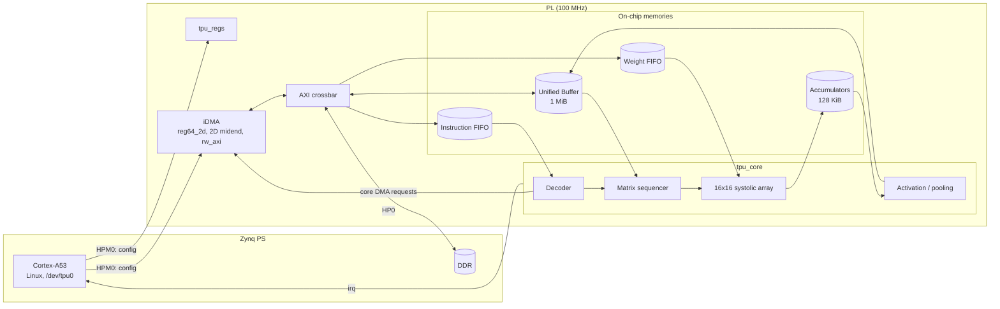

# TPU-KV260

A small INT8 neural-network accelerator modelled on Google's TPU v1 [(Jouppi et al., ISCA 2017)](https://arxiv.org/abs/1704.04760), built for the Kria KV260 board. It comes with a Linux driver, a compiler from quantized models to accelerator programs, and a golden model that every test is checked against.

It runs MLPs and small CNNs on the board today. It is not a general inference engine yet; see [Limitations](#limitations).

## Background

This started as the systolic-array neural-network accelerator I designed and simulated on FPGA during my IC design internship at Polytron (IC design learning program). It could already do inference, just only the basic cases, and I wanted to take it further.

This repo is where I took it further, building out the rest of the stack:

- Architecture: follows the TPU v1 paper. A Unified Buffer, weight FIFO, accumulators and an instruction FIFO sit around a 16x16 weight-stationary array.
- Instruction set: 16-byte instructions (DMA, matmul, convolve, activate, sync, halt). Convolution reads straight from the buffer.
- DMA: PULP iDMA, driven by the host or by the accelerator's own decoder, so a whole network starts from one call.
- Software: a Linux kernel driver, a runtime, and compilers that turn quantized MLP and CNN models into accelerator programs.
- Verification: a Python golden model that every result has to match bit for bit, in Verilator on the KV260.

AI coding assistants helped with parts of the implementation and tests.

## Tools

| | |
|---|---|
| FPGA | AMD Vivado 2025.2, Kria KV260 (Zynq UltraScale+ XCK26)|
| Simulation | Verilator 5, Cadence Xcelium 24.09 |
| Verification | UVM, a Python golden model, on-board testing |
| IP and dependencies | PULP iDMA v0.7.4, PULP AXI, Bender |
| Software | Linux kernel module (Kria Ubuntu), C and Python, NumPy |

## Design



16x16 weight-stationary array, INT8 multiply with INT32 accumulate, 100 MHz (51.2 GOPS peak). Activate does TFLite-style requantization, ReLU/ReLU6 and 2x2 max or average pooling. The instruction set is in `docs/architecture.md`.

## Results

Measured on a KV260 at 100 MHz.

| | |
|---|---|
| Timing | setup slack +1.25 ns, hold +0.01 ns |
| Resources | 32.2k LUT, 40k FF, 328 DSP48E2, 32 URAM, 44 BRAM36 |
| Large MLP (`mlp_wide`) | 354 us, 37 GOPS, 72% of peak array utilization |
| Small MLPs | 67 us (`mlp3`), 153 us (`digits_b128`) |
| Digits MLP | 91.7% on the TPU and in the INT8 golden model, identical on 1000 samples (float: 91.8%) |

Small layers are limited by weight bandwidth, not by the array. Utilization only gets high with large layers or batches.

## Layout

```
rtl/        SystemVerilog (compute, memory, control, activation, top)
tb/         Verilator / Xcelium testbenches and a UVM environment
model/      golden models, quantization, MLP and CNN compilers, ISA simulator
software/   kernel driver, C/Python runtime, board scripts
soc/vivado/ block design, constraints, build scripts
docs/       architecture specification
```

## Building and running

Dependencies (PULP `axi`, `iDMA` v0.7.4) are pinned with [Bender](https://github.com/pulp-platform/bender); see `Bender.yml`, `Bender.lock` and `Bender.local`.

```
python3 model/cnn/test_cnn.py                    # CNN golden model
python3 software/runtime/tests/test_host.py      # runtime against the mock device
```

The bitstream is built from `soc/vivado/scripts/`. On the board, load the image with `xmutil` and then run `software/driver/tpu-load.sh`; `/dev/tpu0` appears once the driver binds.

## Limitations

- A convolution layer's output is limited to 1,024 pixels (for example 32x32 at stride 1), because the whole layer sits in one half of the accumulators. Larger images need a banded compiler, which I haven't written.
- Not supported: LSTM, residual add, leaky ReLU, SiLU, upsampling, stride-1 max pool.
- A program is at most 2,048 instructions, one job at a time.

## Next

- LSTM inference.
- Sigmoid and tanh lookup tables in the activation unit.
- Element-wise multiply and add, with an int16 cell state and TFLite-style integer arithmetic.
- LSTM support in the ISA, compiler and golden model, then a check on the board.

## License

MIT, see [`LICENSE`](LICENSE). The PULP dependencies keep their own licenses.
