# TPU-KV260: Architecture Diagrams, Bottom to Top

Current state: **v1.3, Phase B + CNN** (`VERSION = 0x0000_0500`, ABI v1).
This page walks the design from the lowest level (one PE) up to the software stack. Each diagram is cross-checked against the RTL instance hierarchy. Details live in the documents linked at the end of each section. Register map and address map: [`interfaces.md`](interfaces.md). ISA: [`isa.md`](isa.md).

Contents:
1. [Layer 1: Processing element and systolic array](#1-processing-element-and-systolic-array)
2. [Layer 2: Matrix unit](#2-matrix-unit)
3. [Layer 3: Memories](#3-on-chip-memories)
4. [Layer 4: Activation and pooling](#4-activation-and-pooling-unit)
5. [Layer 5: Control (decoder and sequencers)](#5-control-decoder-and-sequencers)
6. [Layer 6: `tpu_core`](#6-tpu_core)
7. [Layer 7: Data fabric (`tpu_fabric`)](#7-data-fabric-tpu_fabric)
8. [Layer 8: iDMA subsystem](#8-idma-subsystem)
9. [Layer 9: `kv260_top` and the PS](#9-kv260_top-and-the-zynqmp-ps)
10. [Layer 10: Linux driver and runtime](#10-linux-driver-and-user-space-runtime)
11. [Layer 11: Model to inference flow](#11-from-model-to-inference)
12. [Run lifecycle (sequence)](#12-run-lifecycle)

---

## 1. Processing element and systolic array

`rtl/compute/mac_pe_ws.sv`, `rtl/compute/systolic_array.sv`

A **weight-stationary** 16×16 array. Each PE holds one INT8 weight (with a shadow register for double buffering), multiplies it by the activation passing left to right, and adds the partial sum arriving from above. The multiplier maps to a DSP48E2 (`use_dsp`).

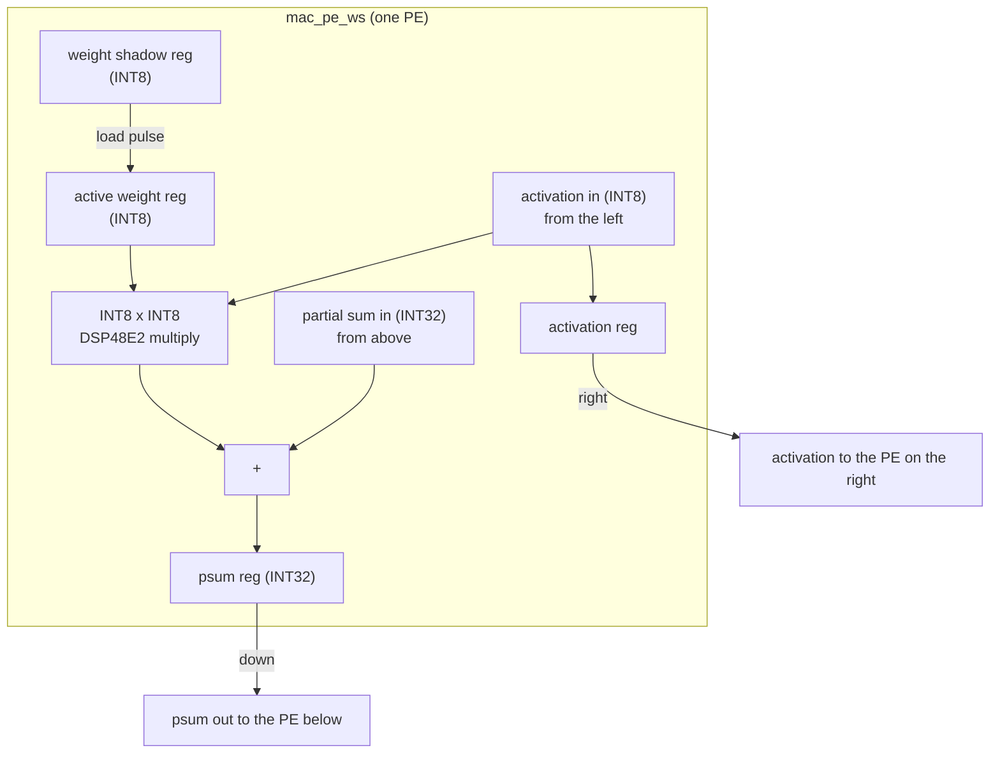

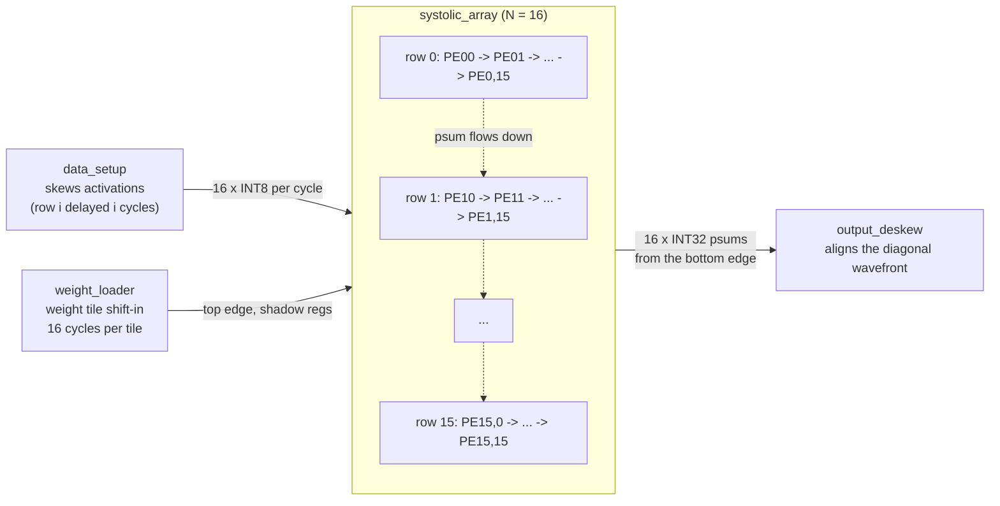

Weight tile word `t` = `W_tile[15-t]` (the loader shifts the last row in first). One matrix instruction: stream N input rows through the array and receive N rows of 16 INT32 sums, 16 cycles of latency after the last input.

---

## 2. Matrix unit

`rtl/compute/matrix_unit.sv`

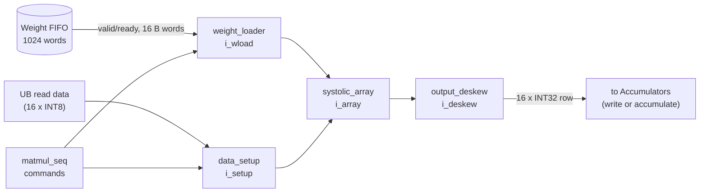

---

## 3. On-chip memories

`rtl/memory/*`. All are accessed from two sides: **port A = AXI** (iDMA and CPU, through `axi_to_detailed_mem`) and **port B = TPU-native** (wide port, no arbitration).

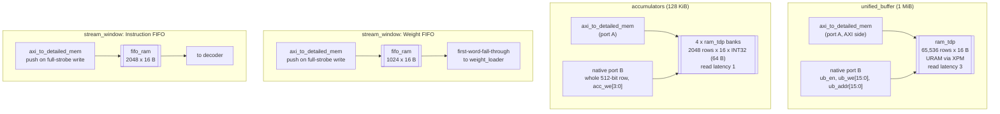

| Memory | Size | Shape | AXI window |
|---|---|---|---|
| Unified Buffer | 1 MiB | 65,536 rows x 16 x INT8 | `0xA010_0000` |
| Accumulators | 128 KiB | 2,048 rows x 16 x INT32 | `0xA020_0000` |
| Weight FIFO | 16 KiB | 1,024 words (64 tiles) | `0xA030_0000` |
| Instruction FIFO | 32 KiB | 2,048 x 16 B instructions | `0xA040_0000` |

Ownership: while `CTRL[1]` (UB) or `CTRL[2]` (ACC) is set, CPU and register-frontend writes are dropped with SLVERR. Core-issued DMA (AXI user bit 0 = 1) is allowed (ADR-0003).

---

## 4. Activation and pooling unit

`rtl/activation/*`

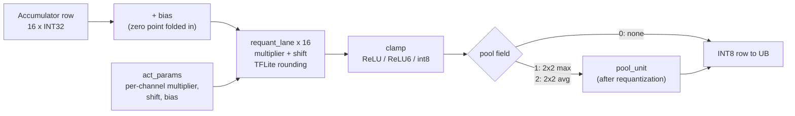

---

## 5. Control: decoder and sequencers

`rtl/control/*`

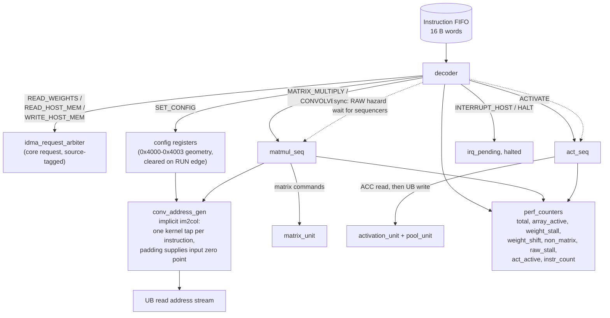

Instruction set (16 B, [`isa.md`](isa.md)):

| Group | Instructions |
|---|---|
| DMA | READ_HOST_MEM, READ_WEIGHTS, WRITE_HOST_MEM |
| Compute | MATRIX_MULTIPLY, CONVOLVE, ACTIVATE |
| Control | SET_CONFIG, SYNC, INTERRUPT_HOST, NOP, HALT |

---

## 6. `tpu_core`

`rtl/top/tpu_core.sv`: instruction FIFO consumer plus the full compute pipeline.

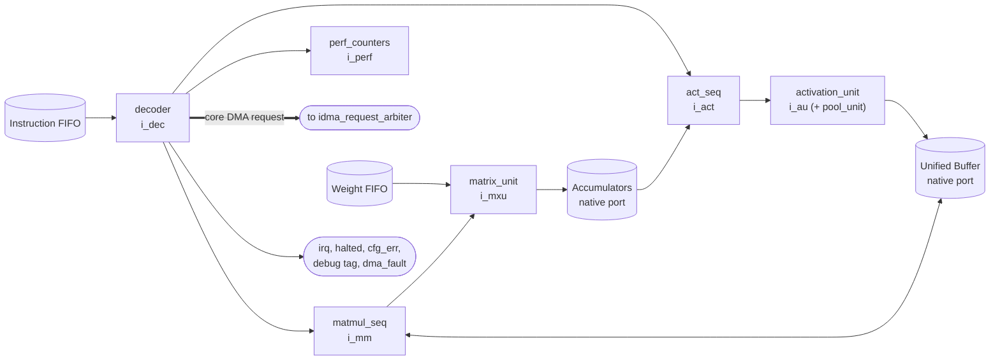

---

## 7. Data fabric (`tpu_fabric`)

`rtl/top/tpu_fabric.sv`: a PULP `axi_xbar` with an `axi_cut` on every slave, which fixed the timing paths into the RAMs (L33).

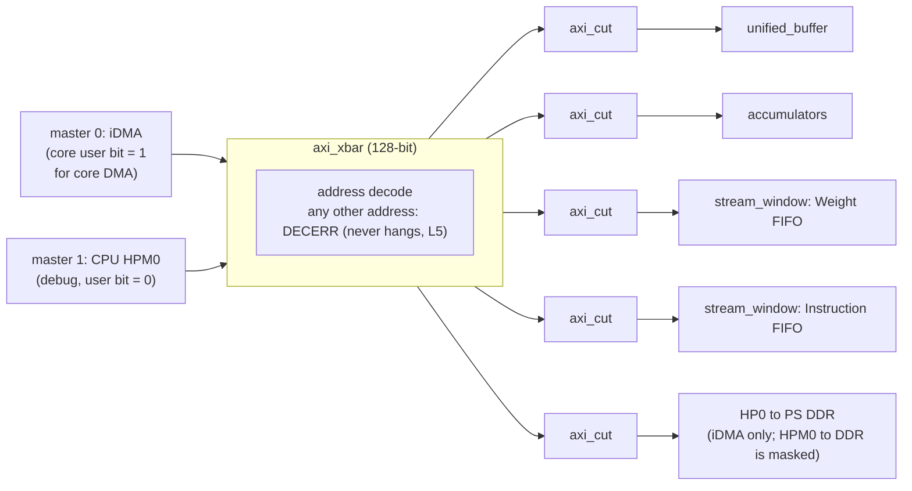

---

## 8. iDMA subsystem

`rtl/top/idma_subsystem.sv`: PULP iDMA v0.7.4. This replaced the AMD AXI DMA IP.

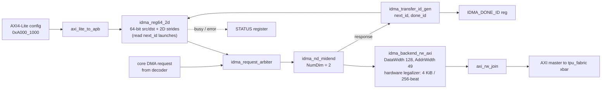

Rules enforced by hardware and the driver: FIFO-window DMA needs a 16 B-aligned source and destination (L36). No same-memory DMA (UB to UB, ACC to ACC) because it deadlocks (L34).

---

## 9. `kv260_top` and the ZynqMP PS

`rtl/top/kv260_top.sv`: one clock domain (`pl_clk0`, 100 MHz), no CDC.

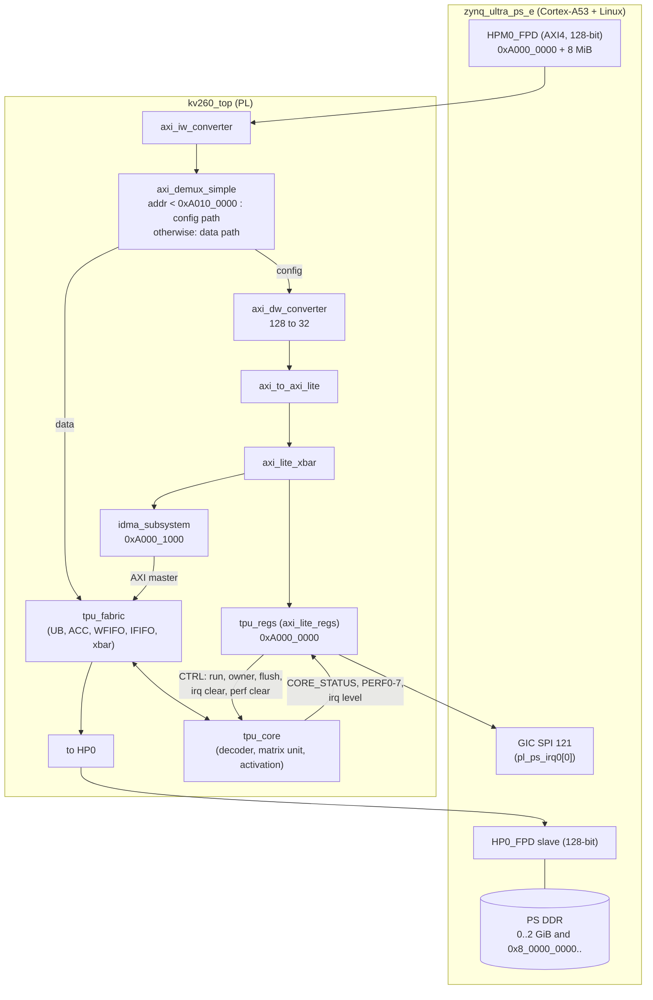

Register summary (`0xA000_0000`): VERSION, SCRATCH, BUILD_ID, IDMA_DONE_ID, STATUS, CTRL, FIFO_LEVEL, CORE_STATUS, IRQ_TAG, PERF0-7, DEBUG_TAG ([`interfaces.md`](interfaces.md) section 2).

---

## 10. Linux driver and user-space runtime

`software/driver`, `software/runtime`

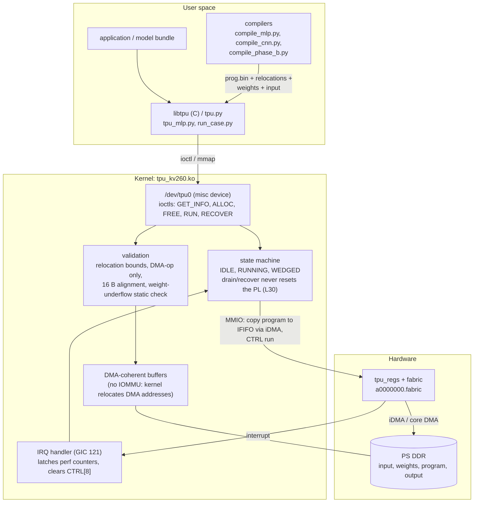

The driver binds to `a0000000.fabric` through `driver_override`. Load with `software/driver/tpu-load.sh`; unload with `tpu-unload.sh`. See [`driver.md`](driver.md) and [`driver_user_guide.md`](driver_user_guide.md).

---

## 11. From model to inference

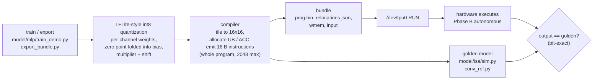

---

## 12. Run lifecycle

One `RUN` ioctl, Phase B (the whole program is preloaded; the core issues its own DMA).

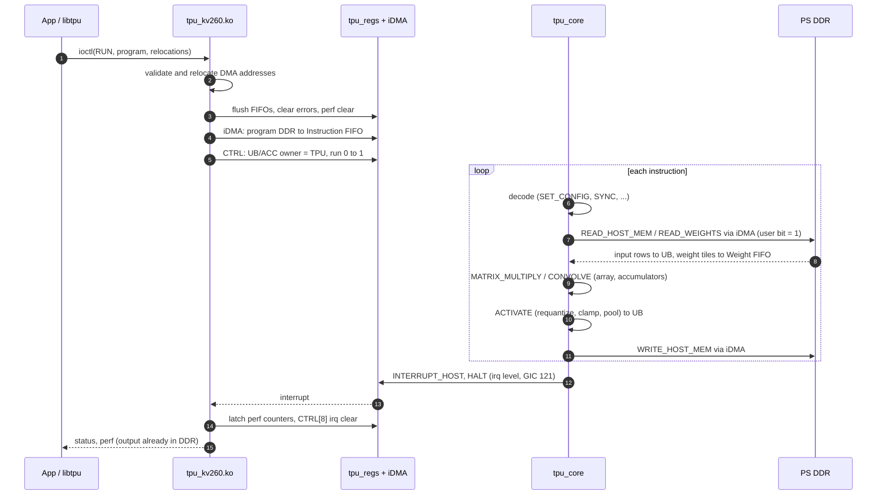

---

## Related documents

| Topic | File |
|---|---|
| Full spec and milestones | [`architecture.md`](architecture.md) |
| Address map, registers, memory windows | [`interfaces.md`](interfaces.md) |
| Instruction encoding | [`isa.md`](isa.md) |
| iDMA parameters and programming | [`idma_integration.md`](idma_integration.md) |
| Core DMA contract | [`m5_core_contract.md`](m5_core_contract.md), [`m5_dma_interface.md`](m5_dma_interface.md) |
| CNN (CONVOLVE, pooling) | [`m6_cnn_contract.md`](m6_cnn_contract.md), [`adr/0004-cnn-convolve-pool.md`](adr/0004-cnn-convolve-pool.md) |
| Driver | [`driver.md`](driver.md), [`driver_user_guide.md`](driver_user_guide.md) |
